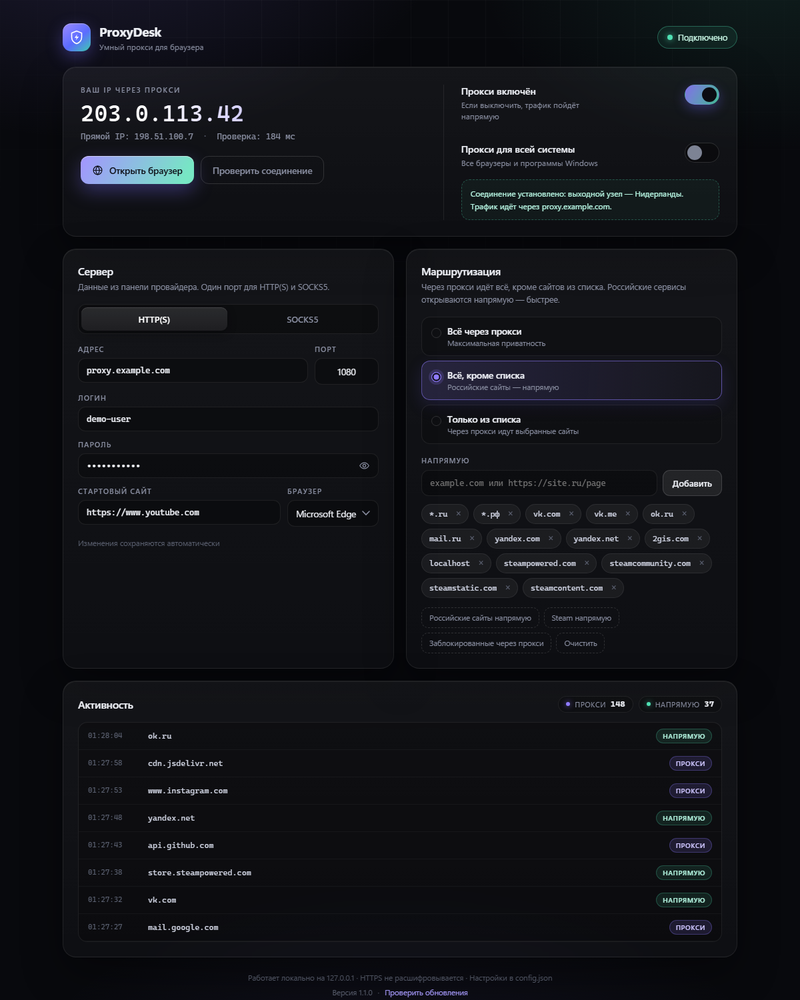

# ProxyDesk

Умный прокси для браузера на Windows. Помогает открывать заблокированные сайты и при этом не гонять весь трафик через зарубежный сервер: российские сайты и Steam открываются напрямую, остальное — через прокси.

## Возможности

- **Свои настройки прокси** — адрес, порт, логин и пароль из панели провайдера. Поддерживаются HTTP(S) и SOCKS5.
- **Три режима маршрутизации**:
  - всё через прокси;
  - всё, кроме списка (по умолчанию российские сайты идут напрямую);
  - только сайты из списка.
- **Готовые списки**: российские сайты, заблокированные сервисы, Steam и его CDN — в один клик.
- **Открывает браузер** (Chrome, Edge, Firefox или Яндекс Браузер) уже с включённым прокси, без изменения системных настроек.
- **Системный прокси для Windows** — по желанию, чтобы через прокси шли все браузеры и программы.
- **Проверка соединения** — показывает ваш IP через прокси, прямой IP, страну выхода и задержку.
- **Журнал активности** — видно, какие сайты ушли через прокси, а какие открылись напрямую.
- **Автообновление** — приложение само проверяет новые версии и предлагает обновиться в один клик.

## Установка

1. Скачайте последний установщик со страницы [Releases](https://github.com/WOLF5ER/proxydesk/releases/latest) — файл `ProxyDesk-Setup-x.y.z.exe`.
2. Запустите его. Windows SmartScreen может показать предупреждение «Windows защитила ваш компьютер», потому что установщик не подписан сертификатом. Нажмите **«Подробнее» → «Выполнить в любом случае»**.
3. Установка занимает несколько секунд и не требует прав администратора.
4. При первом запуске введите данные прокси из панели провайдера — адрес, порт, логин и пароль. Настройки сохраняются автоматически.

Приложение работает в фоне; панель управления открывается в браузере по адресу `http://127.0.0.1:8790`.

## Как пользоваться

1. Заполните блок **«Сервер»** данными из панели провайдера.
2. Выберите режим в блоке **«Маршрутизация»** — по умолчанию «Всё, кроме списка».
3. Нажмите **«Проверить соединение»** — вверху появится ваш IP через прокси.
4. Нажмите **«Открыть браузер»** — откроется отдельное окно браузера, в котором весь трафик уже идёт по правилам маршрутизации.

### Steam

Если Steam долго грузит витрину, нажмите **«Steam напрямую»** в блоке «Маршрутизация»: страницы Steam и его CDN начнут открываться напрямую и станут заметно быстрее. Магазин при этом продолжит работать — Steam-клиент подхватывает системный прокси, если включён переключатель «Прокси для всей системы».

## Приватность

- Прокси работает локально на `127.0.0.1:8899` — снаружи к нему подключиться нельзя.
- HTTPS-трафик не расшифровывается: устанавливается обычный туннель, содержимое страниц прокси не видит.
- Логин и пароль хранятся только на вашем компьютере в `%APPDATA%\ProxyDesk\config.json`.
- Приложение не отправляет телеметрию и не обращается в сеть, кроме проверки обновлений на GitHub.

## Частые вопросы

**Антивирус / SmartScreen ругается на установщик.** Установщик не подписан платным сертификатом — это обычная ситуация для небольших приложений. Скачивайте его только со страницы Releases этого репозитория.

**Вкладка закрылась, а прокси остался включённым.** Приложение продолжает работать в фоне. Откройте `http://127.0.0.1:8790` или ярлык ProxyDesk, чтобы вернуться к панели.

**Как обновиться?** Когда выйдет новая версия, вверху панели появится кнопка «Обновиться» — она сама скачает и запустит установщик. Настройки и данные прокси сохранятся. Текущую версию видно внизу страницы.
